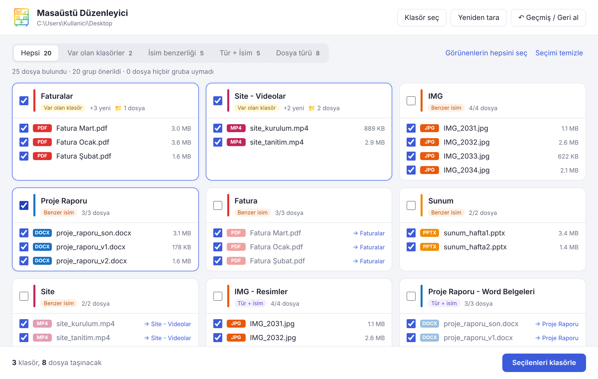
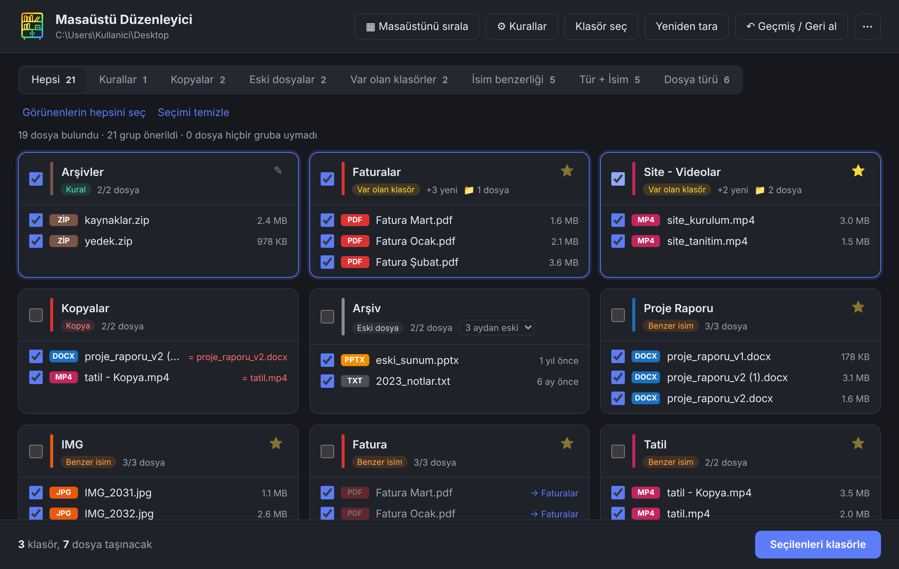

# Masaüstü Düzenleyici

Masaüstündeki dağınıklığı toplamak için Windows uygulaması. Dosyaları **benzer isme**, **dosya türüne** ve **var olan klasörlerine** göre gruplar. Hangi grupların klasöre konacağını sen tikleyerek seçersin, her işlem tek tek geri alınabilir.



<details><summary>Karanlık tema</summary>



</details>

## Özellikler

- **Benzer isim:** `rapor_v1`, `rapor_v2`, `Rapor son (1)` → **Rapor**. Sayılar, `v2`, `(1)`, `son`, `final`, `kopya` gibi ekler ve `index.html.txt` gibi çift uzantılar yok sayılır. Türkçe karakterler ve `I/ı` farkı doğru işlenir.
- **Dosya türü:** Resimler, videolar, PDF'ler, Word, Excel, sunumlar, arşivler, kısayollar ve diğerleri.
- **Tür + isim:** Benzer isimli dosyalar türüne göre de ayrılır, örneğin **Site - Videolar** ve **Site - Resimler**.
- **Kalan dosyalar:** Hiçbir gruba girmeyen dosyalar listenin sonunda tek bir kartta toplanır; oradan sürüklenip istenen karta ya da yeni bir klasöre bırakılabilir.
- **Kalıcı kurallar:** Klasör bazlı kurallar tanımlayabilirsin, örneğin **Faturalar** klasörüne "adı *fatura* ile başlayan **veya** *dekont* içeren" dosyalar. Koşullar: adı şununla başlıyor / şunu içeriyor / şununla bitiyor, türü ve uzantısı. Bir kuralda koşullar "ve" ile birleştirilebilir. Hedef, masaüstündeki bir klasör adı ya da başka bir yerdeki tam yol olabilir. Herhangi bir grup kartındaki ⭐ ile o gruptan kural önerisi alınır. Kurala uyan dosyalar **Kurallar** sekmesinde tikli gelir; istersen "Açılışta kuralları otomatik uygula" ile uygulama açılınca sormadan taşınır.
- **Var olan klasörler:** Klasörlerin içine bakar. Dışarıdaki yeni dosya bir klasördekilerle aynı isim ve türdeyse, ya da klasörün adı bir türse (**Videolar**, **Faturalar**), o klasöre eklemeyi önerir.
- **Sen seçersin:** Her grubu ya da gruptaki tek tek dosyaları tikleyebilirsin. Klasör adını değiştirebilir, dosyaları sürükleyip başka gruba ya da yeni bir klasöre taşıyabilirsin.
- **Masaüstünü sırala:** Klasörleme sonrası dağınık kalan simgeleri tek tuşla türe, ada, eklenme tarihine, değiştirme tarihine ya da boyuta göre düzenli dizer. Windows'un kendi "Sıralama ölçütü" özelliğini kullanır, dosyalara dokunmaz. İstersen "Otomatik düzenle" ile simgeler hep sıralı kalır.
- **Kopyalar:** İçeriği birebir aynı olan dosyaları bulur (önce boyut, sonra SHA-1 karşılaştırması) ve fazlalarını **Kopyalar** klasörüne taşımayı önerir. Her kopyanın yanında hangi dosyayla aynı olduğu yazar; en eski dosya asıl kabul edilir ve yerinde kalır.
- **Eski dosyalar:** 1, 3, 6 ya da 12 aydır değiştirilmemiş dosyaları **Arşiv** klasörüne önerir. Kısayollar hariç tutulur.
- **Arka planda çalışma:** Pencere kapatılınca uygulama sistem tepsisinde çalışmaya devam eder ve masaüstünü izler. Kurallar otomatikse yeni gelen dosyalara da uygular ve taşıdığında bildirim gösterir. İstenirse her yeni dosya için de bildirim açılabilir. İstenirse Windows açılınca arka planda başlar.
- **Tema:** ⋯ → Ayarlar'dan **Sistem** (Windows'u takip eder), **Açık** ya da **Koyu** seçilebilir.
- **İlk açılış rehberi:** İlk açılışta 4 adımlık kısa bir tanıtım gösterir; ⋯ menüsünden tekrar açılabilir.
- **Güvenli taşıma:** Hiçbir dosyanın üzerine yazılmaz. Aynı isimde dosya varsa `dosya (2).pdf` olarak kaydedilir. Taşımadan önce özet gösterilir.
- **Seçmeli geri alma:** Son 50 işlem saklanır. İstediğin işlemi ya da bir işlemin içindeki tek bir klasörü geri alabilirsin. Var olan klasörlere eklenen dosyalar geri alınınca klasör ve içindeki eski dosyalar yerinde kalır.
- **OneDrive uyumlu:** Eşitleme sırasında kilitlenen klasörler için silme tekrar denenir.

## Kurulum

### Hazır kurulum dosyası

[Releases](../../releases) sayfasından `Masaüstü Düzenleyici Setup x.x.x.exe` dosyasını indirip çalıştır.

Uygulama imzalı olmadığı için Windows SmartScreen uyarı verebilir. **Ek bilgi** → **Yine de çalıştır** ile devam edebilirsin.

### Kaynak koddan çalıştırma

[Node.js](https://nodejs.org) (LTS) gerekir.

```bash
git clone <bu deponun adresi>
cd masaustu-duzenleyici
npm install
npm start
```

npm Electron'un kurulum betiğini onay istediği için çalıştırmadıysa:

```bash
npm install-scripts approve electron
npm rebuild electron
```

### Kurulum dosyası oluşturma

```bash
npm run dist
```

`dist/` klasöründe `Masaüstü Düzenleyici Setup x.x.x.exe` oluşur. Simge, GitHub'dan ek araç indirmeden `rcedit` ile .exe'ye yazılır.

## Nasıl çalışır

Gruplama sırası şöyledir:

1. Dosya adları anlamlı kelimelere ayrılır, gürültü ekleri atılır.
2. Temizlenmiş adı aynı olan dosyalar gruplanır. Kalanlar ilk kelimelerine göre ikinci kez denenir (`Fatura Ocak`, `Fatura Şubat` → **Fatura**).
3. İsim grupları ayrıca türlerine göre bölünür (**Tür + isim**).
4. Her türün bütün dosyaları ayrı bir tür grubunda toplanır.
5. Alt klasörler taranır ve içlerindeki dosyaların baskın kelimesi ve türüne göre bir profil çıkarılır. Dışarıdaki dosyalar bu profillerle karşılaştırılır.

Aynı dosya birden fazla grupta görünebilir. Birden çok grup seçilirse dosya **ilk tiklenen** gruba gider, diğer kartlarda yanında `→ klasör adı` yazar.

`desktop.ini`, gizli dosyalar ve `package.json` ya da `node_modules` içeren proje klasörleri dikkate alınmaz.

## Proje yapısı

| Dosya | Görevi |
|---|---|
| `main.js` | Electron ana süreci, pencere ve IPC kanalları |
| `preload.js` | Arayüze açılan güvenli fonksiyonlar (`contextIsolation`) |
| `fileops.js` | Tarama, taşıma, işlem geçmişi ve geri alma |
| `desktop-arrange.js` | Masaüstü simgelerini Explorer'ın görünümü (IFolderView2) üzerinden sıralama |
| `grouping.js` | Gruplama ve var olan klasörlerle eşleştirme |
| `renderer.js`, `index.html`, `styles.css` | Arayüz, sürükle-bırak, geçmiş penceresi |
| `build/` | Simge dosyaları ve paketleme sonrası simgeyi .exe'ye yazan betik |

## Teknolojiler

- [Electron](https://www.electronjs.org/) ve Node.js `fs/promises`
- Saf HTML, CSS ve JavaScript (çerçeve kullanılmadı)
- [electron-builder](https://www.electron.build/) (NSIS kurulum dosyası) ve [rcedit](https://github.com/electron/rcedit)

## Bilinen sınırlar

- Sadece Windows'ta test edildi.
- Alt klasörlerin yalnızca ilk seviyesine bakılır.
- İsim benzerliği kurala dayalıdır. Kelime sırası farklı ya da yazım hatalı adlar eşleşmeyebilir.
- O an açık olan dosyalar (ör. Word'de açık bir belge) taşınamaz. Uygulama bunları listeler.
- Ortak masaüstündeki (`C:\Users\Public\Desktop`) kısayollar listelenmez.

## Lisans

[MIT](LICENSE) © 2026 Metehan Dağhan
